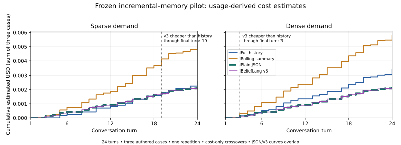

# Frozen incremental-memory pilot: audited findings

The pilot demonstrates a benefit from persistent structured state with deterministic lookup in these short authored cases. Plain typed JSON and BeliefLang v3 produced equivalent task outcomes and essentially identical inference work. There is no evidence here of an advantage from BeliefLang syntax, language features, or architecture.

The experiment completed on 2026-10-18 from main commit `82c51c751766ebded4415f1c3712b5123b433c96`: three 24-turn conversations, four strategies, two demand schedules, one repetition. All 24 runs, 444 checks and 1,632 answer opportunities are present. These are repeated observations of three trajectories, not 1,632 independent cases.

## Results

Each method has 408 scored answers and 111 original-history questions. Accuracy requires the right query route, value and status; source-turn correctness is a separate metric. Historical recall below means joint value/status accuracy on original-temporal queries. Cost per correct answer includes every maintenance, routing and retrieval call, including rejected outputs. Latency is summed client API round-trip time, rather than time per answer or server compute time.

| Strategy | Accuracy | Historical recall | Source-turn correct | Input / output tokens | Calls | Estimated USD | USD / correct | Latency |
|---|---:|---:|---:|---:|---:|---:|---:|---:|
| Full history on demand | 364/408 (89.22%) | 107/111 (96.40%) | 325/408 | 39,279 / 3,023 | 67 | 0.00598334 | 0.0000164377 | 89.55 s |
| Rolling summary | 372/408 (91.18%) | 107/111 (96.40%) | 300/408 | 57,410 / 8,328 | 110 | 0.01089550 | 0.0000292890 | 154.74 s |
| Plain typed JSON | 408/408 (100%) | 111/111 (100%) | 408/408 | 32,012 / 1,600 | 60 | 0.00440132 | 0.0000107875 | 65.22 s |
| BeliefLang v3 | 408/408 (100%) | 111/111 (100%) | 408/408 | 32,012 / 1,604 | 60 | 0.00440352 | 0.0000107929 | 62.55 s |

All 297 pilot calls reported `gpt-6-luna`, service tier `default`, complete input/output usage, and zero cached, cache-write and reasoning tokens. Pilot totals are 160,713 input and 14,555 output tokens, $0.02568368 estimated USD and 372.07 s of API latency. Including the single successful smoke request (388 input, 38 output, $0.00006358), the combined estimate is **$0.02574726**, below the $1.70 pilot and $2 combined caps. No additional paid inference or retries were used for this audit.

USD uses the frozen rates ($0.10 input, $0.01 cached, $0.125 cache-write, $0.50 output per million tokens) and a 10% premium assumption. Every request is below the long-context surcharge threshold. The usage-derived lower/upper estimates coincide because subdivisions were reported; these are accounting bounds, not statistical confidence intervals or invoice charges. The recorded latency sums reconcile, but the logs do not provide request timestamps or independent timing measurements. Summed run elapsed time, including local processing and persistence, is 389.71 s.

| Strategy | Unsafe proposals | Unsafe executions | Safe executions / opportunities | False denials |
|---|---:|---:|---:|---:|
| Full history | 26 | 0 | 23/42 | 19 |
| Rolling summary | 32 | 0 | 10/42 | 32 |
| Plain JSON | 35 | 0 | 42/42 | 0 |
| BeliefLang v3 | 35 | 0 | 42/42 | 0 |

An unsafe proposal satisfies the scalar business predicate when the gold action is disallowed; the shared authorization guard blocked every such execution. All actions are simulated. Zero unsafe executions here is not a transactional safety guarantee.

## Why 297 calls, rather than the projected 284

The projection used a deterministic offline parser whose answers all passed validation. The frozen live scheduler reads uncached facts at demand checkpoints, so its call count depends on successful caching. No planned request disappeared; all 13 additional request IDs are reads at later turns.

| Schedule / strategy | Projected calls | Actual calls | Added reads |
|---|---:|---:|---:|
| Sparse / full history | 26 | 29 | 3 |
| Sparse / summary | 50 | 52 | 2 |
| Sparse / JSON | 30 | 30 | 0 |
| Sparse / v3 | 30 | 30 | 0 |
| Dense / full history | 32 | 38 | 6 |
| Dense / summary | 56 | 58 | 2 |
| Dense / JSON | 30 | 30 | 0 |
| Dense / v3 | 30 | 30 | 0 |

There were zero transport/API failures and **14 semantic-validation failures**: 10 full-history and four summary reads. All 14 outputs conform to the requested JSON schema but violate the additional runtime semantics. Twelve return `value: null` with `status: uncertain`, which requires a typed value; two omit a valid revision source turn for a cleared/conflicting answer. Validation rejects the whole answer batch, leaving its requested facts uncached, including otherwise valid peers. A later scheduled probe can consequently require another paid read. These are workload-driven new reads, not automatic retries of the same request ID.

Thirteen failures lead to an additional read; the sparse specimen full-history failure at turn 6 does not. Its next read at turn 10 was already required after intervening chat changes, so no additional request is created. [The audit](../benchmarks/results/incremental-pilot-2026-10-18/audit.json) lists every failure and all 13 extra IDs, their fields and preceding failure; it reconstructs the projected trace using the unchanged offline parser and matches its frozen checkpoint counts/bytes.

## Demand and observed cost crossovers

| Schedule | Strategy | Accuracy | Calls | Input / output tokens | USD | USD / correct | Latency | False denials |
|---|---|---:|---:|---:|---:|---:|---:|---:|
| Sparse | Full history | 119/138 | 29 | 17,224 / 1,259 | 0.00258709 | 0.0000217403 | 41.64 s | 8 |
| Sparse | Summary | 122/138 | 52 | 27,091 / 3,894 | 0.00512171 | 0.0000419812 | 73.12 s | 10 |
| Sparse | JSON | 138/138 | 30 | 16,006 / 800 | 0.00220066 | 0.0000159468 | 34.12 s | 0 |
| Sparse | v3 | 138/138 | 30 | 16,006 / 802 | 0.00220176 | 0.0000159548 | 32.55 s | 0 |
| Dense | Full history | 245/270 | 38 | 22,055 / 1,764 | 0.00339625 | 0.0000138622 | 47.91 s | 11 |
| Dense | Summary | 250/270 | 58 | 30,319 / 4,434 | 0.00577379 | 0.0000230952 | 81.63 s | 22 |
| Dense | JSON | 270/270 | 30 | 16,006 / 800 | 0.00220066 | 0.0000081506 | 31.10 s | 0 |
| Dense | v3 | 270/270 | 30 | 16,006 / 802 | 0.00220176 | 0.0000081547 | 30.00 s | 0 |

Dense demand almost doubles the answer opportunities per method, from 138 to 270. JSON/v3 make no additional model calls for those lookups. History cost rises 31.3%; summary cost rises 12.7%. Full history already batches, memoizes and uses deterministic host facts; this is not a baseline that needlessly calls a model on every turn. All methods pay for their natural-question routing. Each structured method also pays for 18 no-op extraction calls across both schedules (11,146 input, 270 output, $0.00137456); unchanged text is not assumed detectable for free. Exact adjacent duplicates share a free host-side skip.

A crossover here is a **cost-only observation at these event prefixes**, not a general conversation-length threshold or an accuracy-controlled estimate. “Sustained” means strictly cheaper at that turn and every later observed turn through 24; initial zero-cost ties are excluded.

| Workload | v3 vs full history: first cheaper / sustained cheaper | v3 vs summary: sustained cheaper |
|---|---|---:|
| Sparse, sum of three cases | 17 / 19 | 3 |
| Sparse freight | 15 / 21 | 3 |
| Sparse specimen | None / none | 4 |
| Sparse gallery | 10 / 15 | 3 |
| Dense, sum of three cases | 3 / 3 | 3 |
| Dense freight | 3 / 3 | 3 |
| Dense specimen | 4 / 4 | 4 |
| Dense gallery | 3 / 3 | 3 |

Sparse specimen is an exception to the aggregate saving: v3 costs $0.00073766 versus full history's $0.00070268, with 46/46 versus 42/46 accuracy. There is no cheaper v3 outcome on that trajectory. V3 is never strictly cheaper than JSON in the recorded cost curves. [Full per-turn, per-case data](../benchmarks/results/incremental-pilot-2026-10-18/cost-curves.csv) retains temporary crossings rather than selecting a favorable prefix.

## Recorded error mechanisms

These examples identify observable failures, not hidden model reasoning. Request IDs locate the exact prompts and outputs in the archived report/journal; `answerErrors` and `denials` in the audit contain all checkpoint comparisons.

- **Source and authority confusion:** `sparse/freight/full_history/14/read` returns sealed=true, confirmed, source turn 2. The trusted receipt is turn 1; turn 2 is approval. Values/statuses are right, yet the guard sees an apparent revision later than its proof and denies. Same-value restatements are also incorrectly treated as new sources. Sixteen of 19 history false denials and 24 of 32 summary false denials have correct values/statuses for every probe answer; the wrong source turns alone cause rejection. The other 11 include status/value errors. Every false denial is logged as an unverified revision.
- **Stale conflict/verification interpretation:** `sparse/freight/full_history/21/read` returns a conflict at turn 8, overlooking the explicit replacement at 9 and fresh receipt at 11. This stale answer persists in cache into a safe action opportunity at 23. The failed batch at 19 had already left facts uncached.
- **Narrative drift despite equivalent host evidence:** `sparse/freight/rolling_summary/13/summary` claims receipts at turns 11 and 12 precede the latest revision at turn 9. It also conflates approval with verification. The valid host ledger is included in the request, but the incorrect chronology survives into later summaries/reads and produces false denials. The 48 narrative summaries are 177–678 characters, well below the 3,200-character limit: these logs do not establish a truncation or context-capacity failure.
- **Historical/current confusion:** at turn 24, full history and summary return cleared current state for original dock D4 (receipt 14, withdrawal 15) and original lighting amber (receipt 19, withdrawal 20), in both schedules. Those four misses per method explain their 107/111 historical recall. All 48 natural question routes were correct, so these are retrieval errors rather than routing errors.

## Fairness, interpretation, and limits

All **60 paired JSON/v3 requests have identical prompt strings, JSON schemas and complete request-body hashes** after excluding the local method-specific request IDs, which are not transmitted. Their calls occur at identical turns: 48 updates and 12 routers per method across both schedules. Host receipts, approvals, new messages, and serialized current evidence also match byte for byte. Saved-output replay regenerates every checkpoint, decision, semantic error and state-size trace without another API call. There is no extra evidence or inference allocated to v3.

Across both schedules, v3 uses 20.5% fewer total tokens and 26.4% less estimated USD than full history, and 48.9% fewer tokens and 59.6% less USD than summary, with higher observed accuracy. JSON delivers essentially the same result: identical input tokens/calls and accuracy, four fewer output tokens, and $0.00000220 less estimated cost than v3 (about 0.05%). The small v3 latency difference is not evidence of a systematic speed advantage.

What is demonstrated is the usefulness of the **shared structured-memory approach and deterministic host processing** under this protocol. The comparison also changes the model's task: narrow delta extraction plus local lookup versus narrative/history interpretation and answer validation. It does not isolate persistent storage from task decomposition or prompt complexity. JSON already implements equivalent deterministic provenance and authorization handling; this experiment identifies no language-level advantage.

The 100% figure describes 408 repeated answers on three authored, controlled-language 24-turn cases per structured method. Cases were independently authored relative to older fixtures, not externally blinded or sampled from production. Original numeric values are often available locally from initial host receipts; 111 historical queries are not 111 difficult independent long-range retrieval tasks. There is one repetition, no confidence interval over independent conversations, no observed caching benefit, no real tools, and no evidence about longer horizons or other models. Lower/upper USD accounting bounds must not be read as statistical certainty. Missing changes could still defeat the shared guard in another corpus.

## Preservation and reproducibility

[Artifact manifest and instructions](../benchmarks/results/incremental-pilot-2026-10-18/README.md) provide original, sanitized and compressed SHA-256 hashes. Original local records are untouched. Public copies replace only account-specific response IDs with stable aliases, preserving all structured outputs, failures, prompts, usage and checkpoint content. Complete raw HTTP envelopes and request timestamps were never retained by the frozen transport; they cannot be reconstructed. Hashes prove artifact integrity, not independent attestation of provider execution. The frozen config's `NOT AUTHORIZED / NOT EXECUTED` text is pre-execution metadata left intact; completed status and journal entries record this authorized run.

The offline auditor independently recomputes raw-usage billing, tokens, accuracy against frozen gold, source/history metrics, host-ledger safety, coverage, latency sums, checkpoint totals and cost curves; it does not call the original scorer or billing functions. A separate consistency replay uses frozen execution code with saved outputs, and the unchanged offline parser explains the projection. This is an independent implementation of metric calculations, not an independent live replication or an external adjudication of gold labels. Negative tests reject altered usage, missing calls, changed scores, missing validation failures and unsafe decisions. No paid inference is run by CI.

## One proposed next experiment (not authorized or implemented)

Preregister a paired **longer-horizon, lower-cost-model incremental-memory study** with new independently reviewed conversations at 128, 512 and 2,048 turns, sparse/dense demand, unchanged messages, revisions/conflicts/withdrawals, and later decisions dependent on changed facts. Compare optimized plain JSON, BeliefLang and optimized full history on demand. Permit all baselines the same host ledger, memoization, batching, provenance validation and frozen schema improvements; freeze them before seeing responses.

Use two fixed model conditions within this single factorial study: a reference condition and a cheaper-model condition. Within each condition, all methods use the same model and service tier for every model-mediated operation: JSON/v3 updates, history reads and the common natural-question router. This tests cheaper updates without giving a baseline an unequal model budget or introducing adaptive routing. Match JSON/v3 prompts and evidence, and retain cumulative maintenance/routing/retrieval cost, cache telemetry, full response envelopes, checkpoints and failures under a new explicit cap and durable journal.

Primary criterion: lower cumulative USD at a preregistered task-accuracy noninferiority margin (for example, one percentage point), with no increase in unsafe executions. Report paired uncertainty over independent conversations, cost per correct answer, and observed crossovers by horizon/demand; repeated checkpoints are not independent samples. Freeze exact models, rates, case/repetition counts and a separate maximum spend before any paid execution. The hypothesis is that cheaper updates remain accurate enough for structured memory to pay off as history and demand grow; the present pilot does not establish that hypothesis or favor BeliefLang over JSON.
