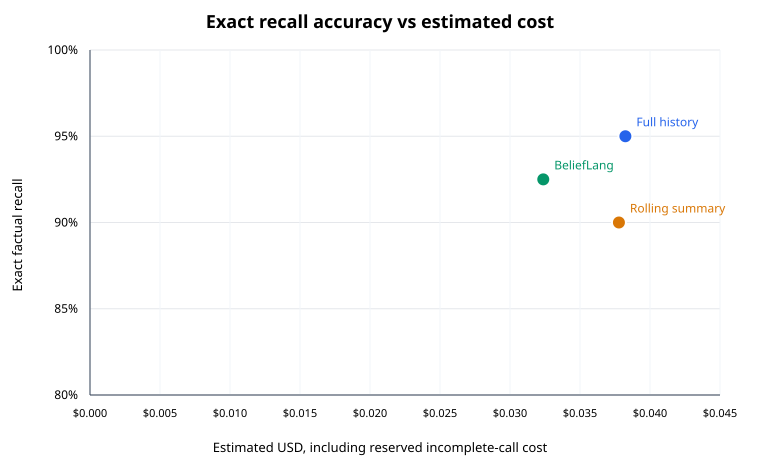
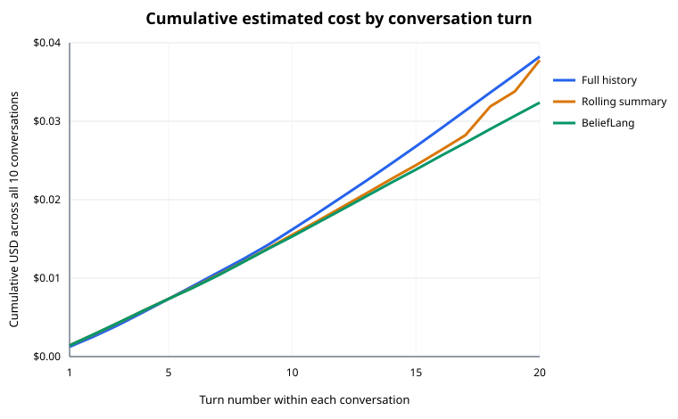

# Long-Horizon Benchmark v2

## Result

Across 40 exact-answer checkpoints in each of three strategies, full history scored 38/40 (95%), rolling summary 36/40 (90%), and BeliefLang 37/40 (92.5%). BeliefLang had the lowest estimated cost per correct answer, but it did not reduce total reported tokens relative to full history. The measured tradeoff is lower output volume and lower estimated cost, with a 2.5 percentage-point lower recall score than full history. One shared fixture-label error affects all three exact-match scores and is described below; treat these as results against the frozen labels, not corrected accuracy estimates.

| Method | Exact recall | Fact retention | Input / output tokens | Cache read / write tokens | Cost incl. failed-call reserve | Cost per correct answer | Critical failures | Median / p95 latency |
| --- | ---: | ---: | ---: | ---: | ---: | ---: | ---: | ---: |
| Full history | 38/40 (95.0%) | 219/267 (82.0%) | 210,436 / 27,939 | 1,028 / 132,852 | $0.038242 | $0.001006 | 0 | 2,051 / 2,695 ms |
| Rolling summary | 36/40 (90.0%) | 203/267 (76.0%) | 204,871 / 22,732 | 1,149 / 86,310 | $0.037780 | $0.001049 | 3 | 1,873 / 2,663 ms |
| BeliefLang | 37/40 (92.5%) | 207/267 (77.5%) | 235,886 / 7,765 | 6,737 / 220,466 | $0.032376 | $0.000875 | 1 | 1,405 / 1,877 ms |

BeliefLang cost 15.3% less than full history and 14.3% less than rolling summary after including the conservative reserve for incomplete responses. Its total reported tokens were 2.2% higher than full history and 7.1% higher than rolling summary. BeliefLang used 72.2% fewer output tokens than full history, while its input-token count was 12.1% higher. Against full history, this run therefore shows a cost/output-token tradeoff rather than an overall token reduction. Against rolling summary, BeliefLang had 2.5 points higher exact recall at lower estimated cost.

At the observed checkpoints, BeliefLang’s cumulative cost first matched or beat full history at turn 6 while recall remained within the predeclared five-point tolerance. Its cost matched or beat rolling summary at turn 10 at the same tolerance. The comparisons pool all ten conversations at each turn; they are small-sample break-even observations, not universal thresholds.

| Turn | Full-history cost | Rolling-summary cost | BeliefLang cost | Full / summary / BeliefLang recall so far |
| ---: | ---: | ---: | ---: | --- |
| 5 | $0.007352 | $0.007364 | $0.007356 | 100% / 90% / 100% |
| 10 | $0.016204 | $0.015528 | $0.015318 | 100% / 95% / 100% |
| 15 | $0.026803 | $0.024404 | $0.023847 | 96.7% / 93.3% / 90.0% |
| 20 | $0.038242 | $0.037780 | $0.032376 | 95% / 90% / 92.5% |

Costs include all successful memory-update and answer calls. Rolling summary’s two incomplete attempts add a combined conservative reserve of $0.003873. Token totals include provider-reported usage only; usage for those incomplete responses was unavailable.

## Method

The new frozen fixture set contains ten fictional conversations of 20 turns each: two each for travel, planning, shopping, troubleshooting, and task management. The conversations include changing values, reversals, pauses, cancellations, interruptions, unrelated questions, resumed work, names, dates, budgets, exclusions, permissions, and explicit status changes. Four labeled checkpoints per conversation test a single exact answer and compare the stored typed facts against the expected state, for 40 checkpoints per method.

Each method uses `gpt-6-luna`, `reasoning.effort=none`, a 512-token output cap, and the same per-turn fact-update and answer contract. Full history sends all user messages so far. Rolling summary asks Luna to replace a factual summary on every turn and pairs that summary with the newest message; every summary update is included in cost and token counts. BeliefLang sends the newest message with a versioned `BeliefRuntime` snapshot. That snapshot stores declared slot types, scalar values, confidence, source turn, and active/cleared status; task status is a constrained enum. It is updated and serialized through the runtime’s typed fact-store methods, rather than represented as a prose summary or unvalidated JSON blob. Expected answers and labels are withheld from every request.

The runner saves an atomic checkpoint after each attempt. It issues no automatic retries. Two final-run responses ended with provider status `incomplete`; each failure was checkpointed, then manually retried by resuming the same frozen run. Both failed attempts remain in the ledger, the total call count, and the cost estimate. The final repetition therefore made 602 attempts for 600 completed turn rows. Six 30-call pilot batches (180 calls) were also run before freezing, and all their costs are included in the total experiment spend.

Reported cost uses provider token usage and the [OpenAI API pricing table](https://developers.openai.com/api/docs/pricing) recorded in the frozen plan: $0.10/M uncached input, $0.01/M cached input, $0.125/M cache-write input, and $0.50/M output. The final evaluation cost is $0.108398, including $0.003873 reserved for the two incomplete responses. The six pilots cost $0.021919, bringing total estimated experiment spend to $0.130317 of the $5 authorization. Cost per correct answer includes each method’s full memory-update and answer-call costs plus its failure reserve.

| Turn | Full-history context chars | Summary context / summary chars | BeliefLang context / snapshot chars |
| ---: | ---: | ---: | ---: |
| 5 | 5,772 | 6,026 / 206 | 6,531 / 772 |
| 10 | 6,074 | 6,105 / 278 | 6,628 / 862 |
| 15 | 6,435 | 6,206 / 332 | 6,715 / 956 |
| 20 | 6,788 | 6,227 / 385 | 6,733 / 972 |

Context size counts the assembled instructions, schema, and method-specific input, so the shared instructions/schema form a large common component. The table also reports the actual rolling-summary and typed-snapshot payload sizes separately. The largest BeliefLang snapshot was 1,096 characters.

## Findings and limitations

Full history had the highest exact recall and fact-retention scores. BeliefLang’s recall was between the two baselines, with the lowest estimated cost and cost per correct answer. Rolling summary was cheapest before failed-call reserves, but its cost after those reserves was close to full history. Shopping was 8/8 for all three methods; the results varied more in travel, planning, and the task-status checkpoints. The confidence Brier scores were 0.141 for full history, 0.202 for rolling summary, and 0.160 for BeliefLang. These scores use only fact records present at checkpoints; missing facts are scored in retention accuracy but omitted from the Brier calculation, so they are not complete calibration estimates.

The frozen fixture has a known owner-label inconsistency in `event_launch`: the conversation names Nina Patel as event owner on turn 4, while the expected state at turns 10, 15, and 20 says “event organizer.” All three methods returned Nina Patel at the turn-15 owner checkpoint, which the frozen scorer counts as wrong; the same contradictory expected owner also lowers state-retention counts. The labels were not changed after the evaluation. Exact string scoring is also format-sensitive: an equivalent date rendered as “October 5, 2027” instead of the expected ISO form is counted wrong. A non-null wrong answer is counted as unsupported; critical failures include wrong or unanswered labeled dates, budgets, exclusions, status, identifiers, permissions, and safety limits. The single-repetition scores are consequently descriptive and should not be treated as real-world reliability estimates.

The benchmark is synthetic, uses only one model alias and one full evaluation repetition, and has no confidence intervals. Provider cache-write semantics and per-request latency can vary. The incomplete responses have no reported token usage, so their cost uses a deliberately conservative reserve. The benchmark scores state and recall decisions, not live bookings, software changes, purchases, or other external actions.

## Reproduction

Run offline checks with `npm run build`, `npm test`, and `npm run benchmark:long-horizon:validate`. Run a new live evaluation only with an explicit spend cap and API key in the environment. Regenerate the analysis and SVG charts from the preserved run with `npm run benchmark:long-horizon:report`.

The [frozen plan](../benchmarks/plans/long-horizon-v2-plan.json) records fixture, configuration, and evaluation-source hashes. The compact [analysis JSON](../benchmarks/results/long-horizon-v2-summary-2026-10-17.json) includes cost-adjusted failure accounting, per-domain scores, context/snapshot growth, and cumulative curves. Its offline report generator was added after the run and does not change any inference, labels, or scores. The complete [final run](../benchmarks/results/long-horizon-v2-final-2026-10-17.json.gz) and all six pilot raw runs are preserved as gzip JSON without API credentials or provider response identifiers: [pilot 1](../benchmarks/results/long-horizon-v2-pilot-2026-10-17.json.gz), [pilot 2](../benchmarks/results/long-horizon-v2-pilot-corrected-2026-10-17.json.gz), [pilot 3](../benchmarks/results/long-horizon-v2-pilot-cancellation-2026-10-17.json.gz), [pilot 4](../benchmarks/results/long-horizon-v2-pilot-enum-2026-10-17.json.gz), [pilot 5](../benchmarks/results/long-horizon-v2-pilot-field-schema-2026-10-17.json.gz), and [pilot 6](../benchmarks/results/long-horizon-v2-pilot-frozen-candidates-2026-10-17.json.gz).
