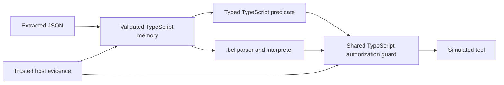

# BeliefLang: product viability and independent benchmark review

## Provisional decision

**Choose Option B: retain a small TypeScript library; do not expand the dedicated
language on the evidence currently available.** Typed factual memory, validated
deltas, explicit uncertainty, history and deterministic authorization are useful
reusable components. None of those benefits depends on `.bel` syntax. The same
business outcomes are achieved by a competent ordinary TypeScript implementation
and by the existing v3 library without its interpreter.

This is a skeptical, single-author desk review and executable software comparison,
not an externally blinded study, a user-productivity experiment or market research.
There are no new live model results. A library is a provisional maintenance choice,
not proof that users need another state manager. If external reuse and a concrete
research question do not materialize, Option C (explicit research-only status) or
D (discontinue) is preferable to maintaining an unused language indefinitely.

This PR implements evaluation examples and tests, not the proposed product
conversion. Production runtime/parser behavior, historical results and the
original frozen v3 evaluation remain unchanged.

## What was compared

| Approach | Factual state and validation | Policy and authorization | What is specifically a language feature? |
| --- | --- | --- | --- |
| Ordinary TypeScript + JSON | A new independent typed state manager; runtime type/enum checks, atomic patches, conflicts, confidence policy, provenance, bounded history and validated journal snapshots | Typed predicates and the same host authorization guard | None required |
| V3 as a TypeScript library | Existing `FactMemory` | The same typed predicates and guard | None required |
| V3 with `.bel` | The same existing `FactMemory` | Actual parsed `.bel` rules, numeric belief merge and `confidence()`; final authorization remains the same host guard | Textual rule syntax, parser/interpreter, belief operators |
| Full history on demand | Conversation/host-event history; processing only when a question, approval or action needs it | The same host authorization contract | No mandatory language or idle-turn extraction |

The fourth implementation is a **structured-event oracle replay**, not an LLM.
It materializes typed history at demand time to check capability parity. Real
full-history extraction quality, token use and latency require separately
authorized model calls. The existing frozen full-query benchmark provides the
future model condition; the new workflow oracle does not replace it or claim its
accuracy.

The plain reference is not the weaker mutable object from the original v3
benchmark. [TypeScriptState](../src/viability/typescript_state.ts) implements its
own validators and merge/history logic; its imports from BeliefLang are **type
only**, erased from JavaScript. Runtime validation is an equivalent alternative
to a Zod dependency. Its generic `applyTyped`/`get` APIs additionally couple field
names to value types at compile time. Untrusted extracted JSON uses a separately
named runtime-validated ingestion path. It does not call `FactMemory` internally.

Snapshot representations differ deliberately: TypeScript serializes a versioned
input journal and reconstructs validated state on restore; v3 serializes current
cells, events, sources and replay receipts and supports existing v1/v2 migration.
Both support round trips and reject invalid inputs in the exercised contract.
The new reference does not implement BeliefLang's legacy numeric-snapshot codec.
That compatibility code is a legitimate existing-library benefit, not evidence
that a dedicated language is necessary. Neither format provides signed evidence,
database transactions or cryptographic tamper resistance.



The model score is used for application intent thresholds, never as factual
verification or authorization. Host identity/authentication and authoritative
constraint verification remain external obligations for every approach.

## Side-by-side workflows

| Workflow | TypeScript application policy | BeliefLang application policy | Exercised behavior |
| --- | --- | --- | --- |
| Travel | [travel.ts](../src/viability/travel.ts) | [travel.bel](../examples/viability/travel.bel) | Changed budget, date cancellation, direct-flight reversal, uncertain intent, competing destinations, stale/revoked approval, original budget |
| Support | [support.ts](../src/viability/support.ts) | [support.bel](../examples/viability/support.bel) | Conflicting resolutions, explicit low-confidence correction, fresh verification, original/previous decisions, refund policy cap, revocation |
| Operations | [operations.ts](../src/viability/operations.ts) | [operations.bel](../examples/viability/operations.bel) | No production authority, expiry, ambiguous intent, release changes, stale/revoked authorization and original release |

[Shared scenario data](../src/viability/workflows.ts) gives each implementation
exactly the same typed events, host verification, approvals and intent scores.
[The controller](../src/viability/compare.ts) records explanations and source
references. [The DSL host](../src/viability/belieflang_host.ts) supplies three
zero-argument callbacks for context, intent and guarded execution. Facts, source
tracking, historical queries and permissions are not declared by `.bel`; they
are managed by those TypeScript components. The numeric intent distribution is
actually merged and read through the interpreter, rather than replacing the DSL
with a precomputed allow/deny boolean.

There are idle messages with no requested action. The full-history oracle performs
no maintenance on those messages. These are realistic business-state and policy
scenarios, not deployed autonomous agents: extraction is supplied, intent scores
are synthetic, and tools only increment a simulated execution counter. Booking
lifecycles, authentication services, production restarts and payment processing
are not exercised.

All four approaches match the same **30 expected action/history outcomes** across
three workflows: 120 checks in twelve runs. Each approach executes nine permitted
simulated actions and makes the same remaining decisions. A separate deterministic
100-update test compares TypeScript and v3 current cells, provenance, historical
retrieval, no-ops and confidence policies. These checks establish software behavior
on the covered contracts, not real-agent accuracy or safety rates.

## Developer experience

| Dimension | Observation | Interpretation |
| --- | --- | --- |
| Rules and thresholds | `.bel` has `when` and `confidence()`; TypeScript uses ordinary typed boolean expressions and constants | Different notation; no demonstrated policy-composition advantage on these workflows |
| Compile-time checking | The TypeScript example rejects wrong field/value pairs and misspelled fields. `.bel` accepts a misspelled property until execution; a misspelled belief label returns confidence zero | TS gives stronger demonstrated editing-time feedback. Zero can be fail-closed but also silently hides a broken rule |
| Runtime validation | Both state managers validate unknown JSON before mutation and preserve unrelated fields | Shared library/state-manager value, not syntax value |
| Uncertainty/conflicts | Both expose confirmed, uncertain, conflicting and cleared state and preserve histories | Ordinary types and deterministic rules provide equivalent behavior |
| Integration | TS calls a predicate/guard directly. DSL needs parsing, tool registration, a context shape and callbacks to the same TypeScript guard | DSL adds a boundary without removing factual-memory integration work |
| Debugging | Guard reasons/provenance are identical. DSL has rule traces, but runtime property errors lack a static field contract | Tracing is useful and can be offered as library instrumentation |
| Logging | `BeliefRuntime.run()` prints state/variables even with tracing disabled; examples subclass only the presentation methods to suppress it | Hosting needs a logging policy; the example workaround is not a production logging API |
| Migration | Existing v3 legacy migration is reusable. A custom journal needs its own version strategy; policy-file grammar changes are another compatibility surface | Keeping the library can preserve existing investment without expanding the language |
| Tool safety | Both go through the same host guard; a direct unguarded tool registration bypasses that protection | Permission enforcement is not automatically supplied by `.bel` syntax |
| Packaging | The repository has a CLI `bin` but no stable root library `exports`/`main`/`types` declaration in package metadata | Option B needs an intentional package/API surface, not just a marketing rename |

Current `.bel` predicates cannot simply wrap at newlines after `&&`; the parser
rejects that form. The three policies consequently have long condition lines.
The language has no native typed factual declarations, historical query syntax,
parameterized tool calls or reusable policy functions in these examples. Moving
conditions into host booleans would shorten the files by moving the work back
into TypeScript; it would not demonstrate better language semantics.

### Code measurements, not productivity claims

The [generated measurements](../benchmarks/viability/offline-review.json) count
nonblank/noncomment physical lines and UTF-8 source bytes. Formatting, imports and
braces count; shared fixtures/controller and reusable dependencies do not enter
the application totals. Approach-specific hosting is reported once, not hidden.

| Application text | TypeScript lines / bytes | `.bel` lines / bytes |
| --- | ---: | ---: |
| Travel policy | 14 / 507 | 6 / 437 |
| Support policy | 13 / 457 | 6 / 389 |
| Operations policy | 11 / 407 | 6 / 372 |
| Approach-specific host/dispatcher | 23 / 729 | 38 / 1,314 |
| Total | **61 / 2,100** | **56 / 2,512** |

The DSL's shorter physical-line count includes lines up to 290 characters. This
is not evidence of faster implementation, easier review or fewer bugs. The host
comparison includes the generic dispatcher used by this harness; an individual
TS application can call its typed predicate directly. No timed developer study,
change-task study, usability study or production incident comparison was done.

Reusable support is separate: the independent TS reference has 391 measured
source lines, existing `FactMemory` 617, and the shared guard 140. The DSL also
uses the parser (572) and broader `BeliefRuntime` (934). Their feature scopes and
compatibility obligations differ, so these are maintenance-surface descriptors,
not an implementation-efficiency ranking. Both approaches share types, fixtures,
the controller, Node/TypeScript and the guard. Native snapshot byte sizes are
reported but use different encodings and exclude shared fixtures, guards and
in-memory caches; they are not comparable model-token measurements.

## Review of the preserved frozen v3 benchmark

The original fixture/configuration/code hashes still validate. The saved raw gzip
hash and recomputed report aggregates match the historical report. A separate
TypeScript state implementation and an independently written authorization
predicate agree with all **80 value/status labels and 70 action labels** in the
recorded typed transition annotations. This is not an independent natural-language
annotation study: a repeated synthetic template and its authored deltas remain
the source of truth. No source-text mismatch was found in this desk review, and
no labels or historical results were corrected.

The new [audit](../src/viability/audit.ts) and
[regression probes](../tests/viability_audit.test.ts) establish the following.
Counts below are for one complete repetition across all six original conditions.

| Finding | Executable evidence | Consequence |
| --- | --- | --- |
| **Gold-category leakage** | 120 answer requests include `task.kind="missing"` or `"contradiction"`. A tag-only construction answers **20/80 questions correctly without reading evidence** | One quarter of the tasks reveal both null value and expected status through metadata. Original live scores cannot be treated as blinded recall evidence |
| **Oracle can hide summary loss** | Force every development summary to the empty string: the mock answer path still gets **6/6** because it reads gold state | Original offline summary scores do not validate retention or dependence on supplied context. This is mock-only; the paid transport does not serialize the oracle argument |
| **V2 verification asymmetry** | 20 v2 mock answers say confirmed although answer context contains active/cleared records, not the host verification evidence used by the oracle | Status scoring mixes representation limits, information access and extraction. Use value-only results separately; a feature-parity comparison needs equal host evidence |
| **V2 stale-proof permission defect** | Clone one case, add approval after the unverified turn-8 revision, keep its unsafe label: v2 executes once; JSON and v3 deny | The v2 adapter's value-only proof lookup reuses old verification after a conflict/reversion. This is a deterministic adapter counterexample, not a measured model failure rate or a change to archived cases |
| **Redundant eager-history input** | 120 eager updates include the newest message both inside history and as the new message | The eager condition is a diagnostic overhead baseline; full query is the relevant economical baseline |
| **Maintenance on already typed host evidence** | 150 update calls include host verification with field/value data | For those covered facts the host can update deterministically, without asking a model to restate known values |
| **Forced answer calls** | JSON and v3 make 160 model answer calls despite supplied target field/temporal routing and local retrieval | Typed factoid answers can be served locally. A real free-text router has a cost, but this experiment supplies routing for free |
| **Repeated action facts** | 210 memory-condition action responses must restate scoped facts already present at the host | Equal responsibilities need not mean identical redundant output. This can penalize stateful methods, not just favor BeliefLang |
| **Verification tied to extraction** | An empty patch plus new host verification leaves an uncertain fact uncertain | The benchmark requires a matching set delta even when the scalar did not change. This conflicts with “no unchanged fields”; host evidence should be processed independently in a future adapter |
| **JSON baseline scope** | Original JSON exposes mutable cells, has no validated restore/migration or configurable confidence policy | It is adequate for the exercised default transition path, not a production feature-parity comparison. The new TS reference fills that evaluation gap |

The original frozen benchmark executes JSON/TypeScript memory APIs, not `.bel`
programs. **Even a future inference-cost win would not establish the value of the
language syntax.** The same opportunity must be available to a competent TS
library. The new DSL examples are the separate evidence about the language itself.

The status-category hints must be removed in a *different*, reviewed protocol
before confirmatory use. Do not silently patch the original or present a reduced
subset as a new independent holdout. The repetitions share authored templates;
three oracle replays do not support a 99.5% real-world reliability claim.

### Authorization limits shared by every approach

The shared guard correctly denies known missing, uncertain, conflicting, cleared,
revoked, expired and stale scoped facts in the tested cases. It assumes host
approvals and verification are trustworthy, checks only declared scope, and does
not discover a change that extraction completely omitted. New tests also confirm
that it grants **standing permission**, not a single-use action ticket: two calls
under the same unchanged approval both execute. Irreversible applications need
an explicit approval-consumption/idempotency policy and external transactional
fencing. These are not capabilities added by the DSL, and the examples do not
claim to solve distributed authorization or booking duplication.

### Accounting and runner review

Positive findings: serial requests, fixed output limits, persist-before-dispatch
reservations, no automatic retries, source/config/fixture/request identity checks,
exclusive journal locks, and usage captured before HTTP/status/output validation.
Known-usage failures remain charged; unknown usage retains the full reservation;
resume never silently retries a failed or interrupted request.

Limits: partial-run summaries omit unfinished conversations (the all-attempt
ledger must also be read); absent cache details are normalized to zero; the core
ledger omits actual response model/service-tier and cache-detail availability;
local oracle time is not provider latency. Cache-write omission can understate
estimated spend if ordinary input prices are used. The proposed budget file
therefore prices **every input category at the highest applicable input/cache
rate**. It is a conservative accounting envelope, not an invoice estimate. The
new smoke helper records model/tier and cache-field availability, persists those
metadata for replay, and fails compatibility on an unexpected model/tier. The
preserved full runner still has its documented telemetry limitations.

## Costed live plan — not authorized and not executed

The [machine-readable plan](../benchmarks/viability/live-plan.json),
[request](../benchmarks/viability/smoke-request.json),
[budget rate envelope](../benchmarks/viability/budget-rates.json) and
[separate freeze](../benchmarks/viability/freeze.json) are prepared. Credentials,
account entitlements, available credit and real API compatibility were **not
inspected**. No paid calls are made by the review, tests or CI. Local checks use
Node 25.1.0; CI uses the existing Node 22 setup.

The original evaluation has 4,500 calls: 450 full-query calls, and 810 each for
rolling summary, plain JSON, v2, v3 and the additional eager-history diagnostic.
The five requested primary conditions alone account for 3,690. Preserving the
original evaluation means retaining its sixth diagnostic rather than silently
filtering the run. Primary analyses should compare the five requested methods.

Planning uses the observed [Luna model/rate documentation](https://developers.openai.com/api/docs/models/gpt-6-luna):
standard input $0.10/M, cache read $0.01/M, cache write $0.125/M and output $0.50/M.
A 10% regional premium is reserved regardless of whether it applies. Long-context
multipliers and the full 1,050,000-token context bound are included in per-request
reservations. These are dated assumptions, not account-specific prices; recheck
before authorization.

| Frozen-run planning scenario | Explicit assumptions | Projected evaluation cost |
| --- | --- | ---: |
| Optimistic | 5 serialized bytes/token; 100 framing tokens/call; oracle-sized state/output | $0.384 |
| Central | 4 bytes/token; same framing and state/output | $0.464 |
| Stress | 3 bytes/token; double state/output sizes; 1,000 framing tokens/call | $1.688 |

These are **conditional projections, not measured tokens or fabricated benchmark
spend**. They price all input at the cache-write envelope and use provider output
caps. Model-generated summaries/state can differ from the oracle. A replay-
conditioned byte-plus-framing/output-ceiling calculation reaches **$11.47**;
it is not a bound for every future model-dependent context. Completion within
$5 cannot be guaranteed. The projections suggest it can fit, subject to failures
and telemetry, rather than providing a statistical probability of completion.

| Stage | Maximum allocation | Rule |
| --- | ---: | --- |
| One compatibility request | $0.30 | `gpt-6-luna`, default service tier, no storage/tools, nested typed structured output, 256-token output limit; stop if model/tier/schema/usage behavior is incompatible |
| Original evaluation OR reduced fallback | $4.00 | One selected protocol, fixed ledgers, all maintenance/answer/action costs and failed-call reservations included |
| Held diagnostic contingency | $0.70 | No automatic retries; at most two **separately approved** diagnostics; original failures/outcomes are never replaced |
| **Combined maximum proposal** | **$5.00** | No reuse/reset of ledgers or running both variants under one allocation |

At the envelope rates, one evaluation reservation is approximately $0.29044; the
smoke reservation is $0.28896. Around twelve unknown-billing failures plus the
central projected work and another reservation can exceed the $4 evaluation
allocation. The journal must stop rather than assuming failures are free. A
provider's price/billing changes, taxes and unrelated account activity are outside
a client-side estimate; project-level billing controls provide an additional cap
where available.

The separately frozen reduced **diagnostic** proposal keeps all ten original
conversations and five primary methods, uses one repetition and makes **1,230
calls**. Its exact methods/repetition count and original fingerprint are in the
new plan. It retains the known category hints and is not a repaired confirmatory
experiment or a new holdout. It can be run through the existing `runSuite` API
with those explicit options; it cannot be selected through the unmodified
original CLI. If diagnostic value is insufficient, do not spend the remaining
budget: design fresh cases and a common, corrected contract under a new freeze.

Recommended sequence after a separate authorization:

1. Verify both freezes and the fixed journal/output paths; select original or
   reduced, never both implicitly. Recheck prices and requested processing tier.
2. Run the single [prepared compatibility helper](../src/viability/live_plan.ts)
   with an explicitly supplied credential, the budget rate envelope and $0.30 cap.
   It has no paid CLI, dotenv loading or credential discovery. Unit tests inject
   HTTP mocks only. Check returned metadata and usage before proceeding.
3. If compatibility passes, run the selected frozen protocol with a $4 cap and
   checkpoint every attempt. Never delete journals/locks to obtain fresh budget.
   Resume recorded outcomes without paying for a retry. Save the complete
   all-attempt ledger, not merely successful-row summaries.
4. Report current/historical value and status metrics separately, contradiction
   handling, attempted and executed unsafe actions, false denials, token totals,
   failure costs/reserves, cost per correct answer, latency, and state growth.
   Keep the original diagnostic limitations visible. Missing billing metadata
   requires bounds, not invented zero-cost calls or exact cache savings.
5. Do not use those model results to claim DSL superiority: compare JSON/v3
   memory effects separately from the `.bel` developer-experience question.

I recommend a compatibility check and a corrected, separately reviewed protocol
before buying purportedly independent accuracy evidence from this frozen set.
The $5 plan is ready for authorization; no spending is implied by this PR.

## Features uniquely justified by BeliefLang

| Candidate | Demonstrated benefit | Unique reason to maintain the language? |
| --- | --- | --- |
| External textual rule notation | Rules can be edited separately from the host | A preference/possible interoperability goal; no demonstrated advantage difficult to achieve with TS functions or validated rule data |
| Exclusive/open/multi beliefs and entropy | Explicit numeric semantics and convenience functions | Useful math/library semantics; callable without a parser and reproducible in ordinary TypeScript |
| Rule traces, CLI and playground | Helpful exploratory tooling | Potential research/teaching value; no measured production or developer-productivity advantage |
| Typed deltas, provenance, conflicts, historical retrieval, snapshots | Verified reusable runtime behavior | **Library value, not language-specific value**; the independent TS implementation matches covered semantics |
| Fail-closed authorization | Verified for known scoped state and approvals | Shared host TypeScript enforcement; not supplied by language syntax or LLM confidence |
| Inference cost reduction | Not measured in this review | Even if later observed, generic memory/context management must be credited before syntax |

**No uniquely necessary language feature is established by this evaluation.**
That is not a proof that every future DSL is useless. Keeping Option A would need
a concrete target user, substantial policy composition/interoperability examples
that remain cleaner than typed TS, static validation/tooling, and a fair developer
change-task study. Counting shorter files or showing an LLM memory-cost chart is
insufficient.

For Option B, extract stable factual-memory/guard APIs and typed validation,
preserve existing data readers, clarify the host trust boundary and standing
permission semantics, and offer a normal package entry point. Keep parser/CLI
compatibility explicitly experimental until actual demand justifies its cost.
Do not implement this product migration without a separate decision. If the
library also has no demonstrated users or distinctive research agenda, prefer
C or D rather than claiming a moat that this evidence does not show.

## Reproduction and verification

All commands below are offline. The direct legacy validator avoids its optional
`.env`-loading npm wrapper. None rewrites historical results.

```sh
npm run build
npm test
node dist/src/multidomain_benchmark.js --validate
node dist/src/long_horizon_benchmark.js --validate
node dist/src/v3_cli.js --validate
node dist/src/viability/review.js --validate
```

Local verification passed: TypeScript build, all **99 tests**, the v1/v2/v3 validators and the new read-only review validator. The new workflow comparison contributes 120 contract checks, not 120 model observations.

The new review validator recomputes workflow outcomes, independently checks
labels, reproduces the audit probes, verifies archived raw hashes/aggregates,
checks the original v3 freeze and checks the separate product-review freeze.
Its `--write`/`--freeze` modes affect only new `benchmarks/viability/` artifacts;
CI uses read-only `--validate`. Source/fixtures may not be refrozen after live
outcomes to create a favorable result. A corrected future confirmatory experiment
needs fresh cases and a disclosed protocol, not rewritten historical evidence.
